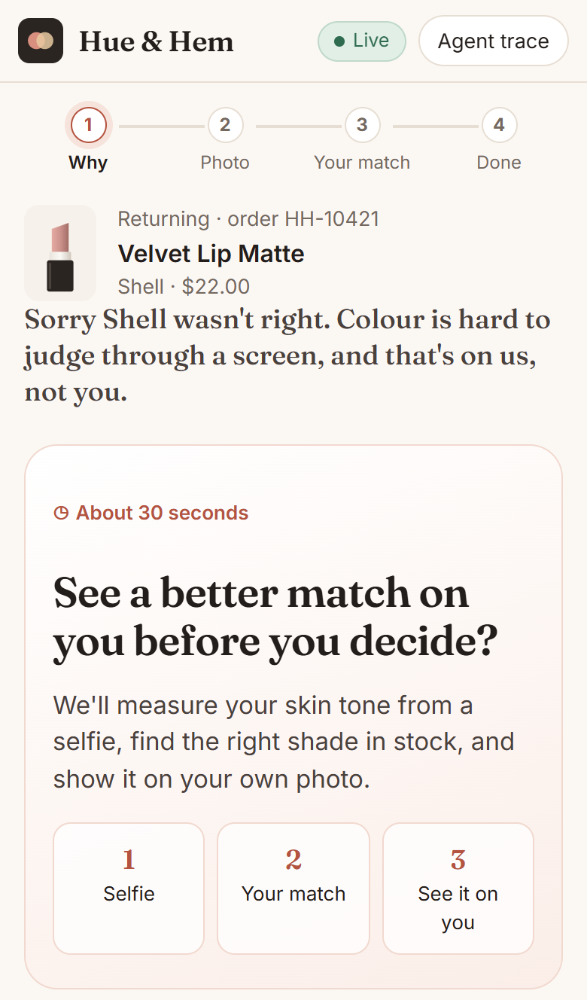
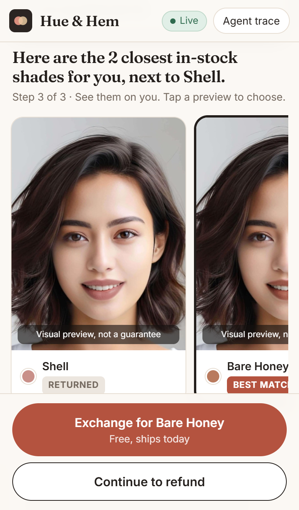
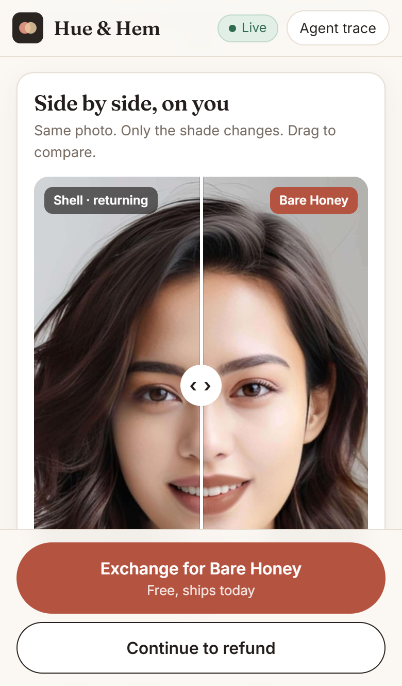
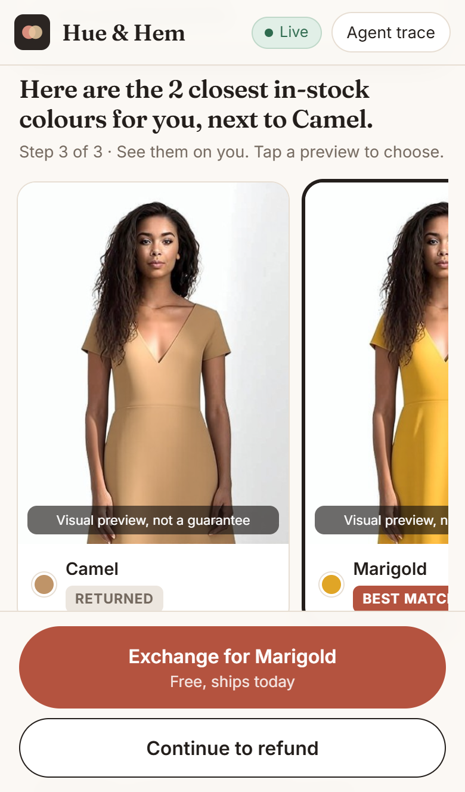
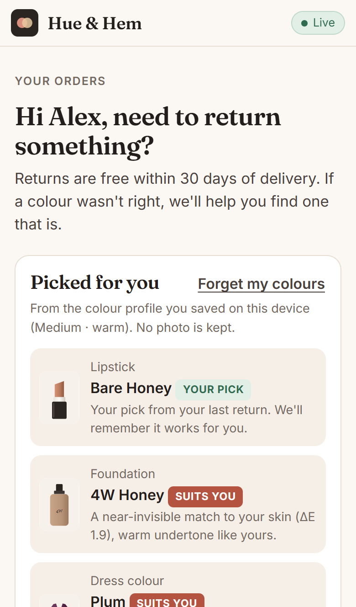
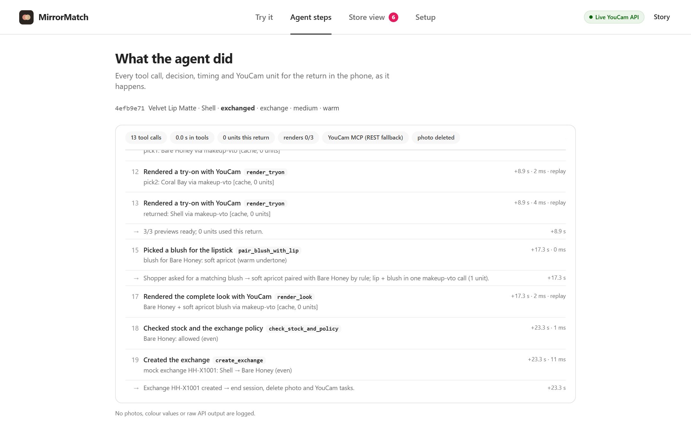
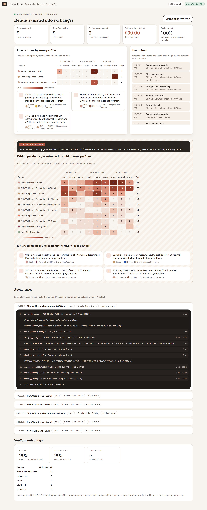
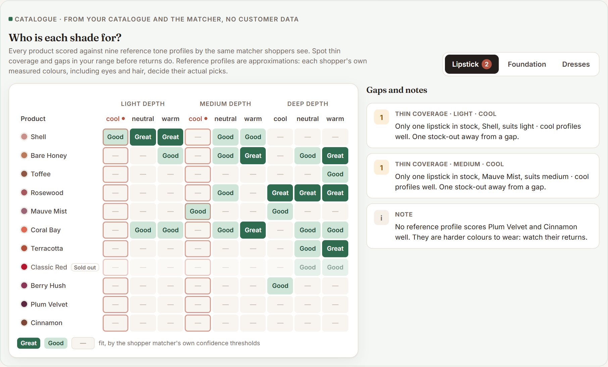
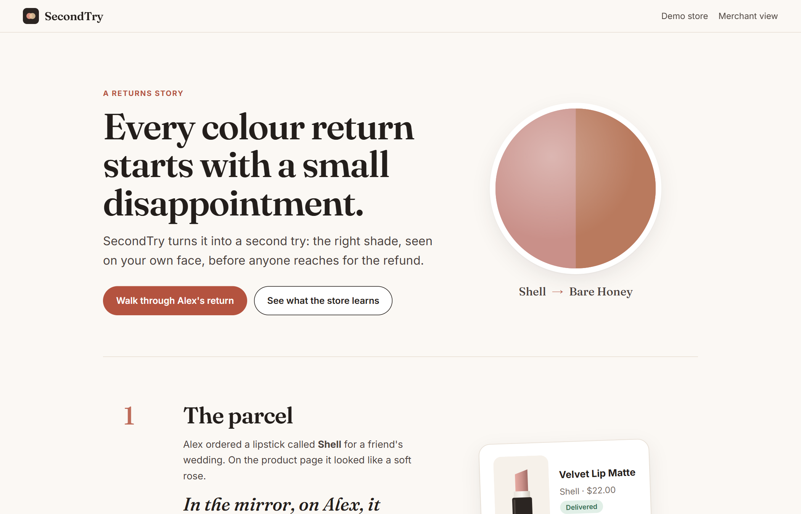
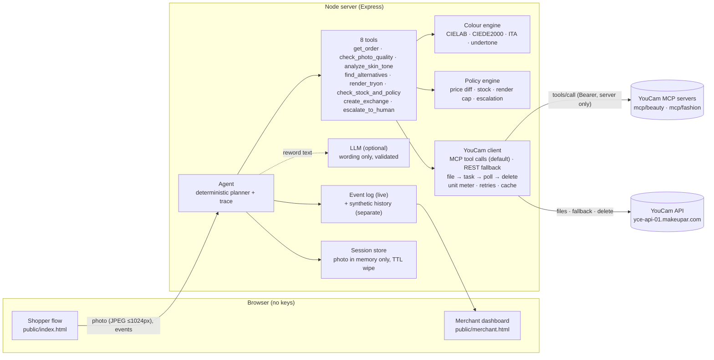

# SecondTry

**The returns desk that gets it right the second time.**

When a shopper starts a return because *"the shade didn't match"* or *"the colour didn't suit me"*, SecondTry:
1. asks for a selfie and measures their skin tone,
2. finds the right shade or colourway in the store's catalogue,
3. shows the alternatives on the shopper's own face or body with virtual try-on, and
4. offers an instant exchange instead of a refund. The refund stays one tap away.

Merchants get a dashboard: refunds turned into exchanges, and which products get returned by which tone profiles.

Built for the **YouCam API Skin AI & eCommerce VTO Hackathon**, **eCommerce VTO** track. Makeup try-on and clothes try-on work together in one returns flow.

Demo store: **Hue & Hem**, a fictional shop. No real brands. Start with the one-minute story at **`/story.html`**.

**Why it's different.** Shade finders guess *before* a purchase. A return is the only time a store learns what actually failed: *this shade, on this tone profile, didn't work*. SecondTry turns each of those moments into a saved sale for the shopper and a fix for the store's catalogue.

| Return offer | Lipstick try-on | Before / after on you |
|---|---|---|
|  |  |  |

| Dress try-on | Colour passport ("Picked for you") | Agent trace (desktop) |
|---|---|---|
|  |  |  |

| Merchant dashboard | Who is each shade for? | Alex's story |
|---|---|---|
|  |  |  |

*The people in the screenshots are YouCam's official API sample images (see `ASSETS.md`). Every preview is labelled "Visual preview, not a guarantee".*

**Demo video (2:52):** Alex's story, then live runs of a lipstick return (with the before/after and the colour passport) and a dress return, followed by the merchant dashboard, the shade-fit grid and the agent trace. The video is linked from the Devpost submission. [`VIDEO.md`](VIDEO.md) has the timeline, the narration, and what was shortened in the edit.

---

## The problem

Shade-matching makeup and colour-sensitive clothing are hard to buy online. You can't hold a lipstick next to your face through a screen.

The moment a shopper picks **"wrong shade"** on a returns form is the clearest signal a store will ever get:
- They still want the product category.
- They now know what *didn't* work.
- They're about to receive a refund, and the merchant is about to lose the sale and pay for the round trip.

Today's returns portals treat that moment as paperwork. SecondTry treats it as a second chance to get the colour right. It uses the same AI the shopper could have used before buying, but at the one point where both sides are already paying attention.

We don't quote industry return-rate statistics here. The dashboard shows only what happens in live demo sessions, plus a clearly labelled synthetic history for illustration.

## What's in it

**For the shopper** (mobile-first)
- **Only for colour returns.** "The shade didn't match" or "The colour didn't suit me" opens the offer; damaged items go straight to a refund.
- **One selfie, then their match.** Skin-tone analysis is turned into a kind summary (depth and undertone), and in-stock alternatives are ranked by colour science, each with a one-line reason.
- **Try-on, makeup and clothes.** The returned item and the top two picks are rendered on the shopper's own photo: lipstick and foundation with makeup try-on, dresses with clothes try-on.
- **Before / after slider.** The returned shade and the chosen pick are shown on the same photo, so only the colour changes. It can be dragged or used from the keyboard.
- **Read my results aloud.** The browser's speech synthesis reads the summary, picks and reasons, for shoppers who'd rather listen.
- **A four-step progress bar**, kind copy ("that's on us, not you"), and the refund one tap away on every screen.
- **Colour passport (opt-in).** After an exchange, the shopper can save their tone numbers (never the photo) on their own device. The orders page then shows "Picked for you" from the same matcher, including the shade they chose. One tap forgets it.

**For the merchant** (desktop)
- **Live:** returns started, exchanges accepted, refund value kept, an event feed and a product × tone-profile return heatmap.
- **Who is each shade for?** Every product is scored against nine reference tone profiles by the shopper matcher itself. Gap cards flag profiles with no good in-stock option ("a gap in your range"), profiles with just one ("one stock-out away"), and live returns that had to be escalated.
- **Insights** from the same matcher ("Shell is returned most by … profiles: recommend … on the product page"). Synthetic illustration data is labelled and kept apart.
- **Agent traces** for every session (tools, timings, units, "over MCP"), and the unit budget from the credit API.

**For a real store's stack**
- **Returns-portal webhook:** `POST /api/integrations/return-started` hands a colour-reason return to SecondTry and gets a link back for the shopper. See [`docs/INTEGRATION.md`](docs/INTEGRATION.md).

## The flow

```
Orders ─▶ Start a return ─▶ Reason?
                              ├─ damaged / other ─▶ refund (no SecondTry)
                              └─ wrong shade / colour didn't suit
                                    ▼
                    "See a better match on you before you decide? (~30 s)"   [Continue to refund]
                                    ▼
                    Consent ─▶ Selfie (or waist-up photo for dresses)
                                    ▼  check_photo_quality (free) → retake guidance if needed
                    analyze_skin_tone (YouCam) → kind summary: depth + undertone
                                    ▼
                    find_alternatives (CIEDE2000 + rules) → check_stock_and_policy
                                    ▼                      └─ low confidence → escalate_to_human
                    render_tryon ×3 (returned + top 2; YouCam makeup VTO or clothes VTO)
                                    ▼  before / after slider · read aloud
                    [Exchange now: free, ships today]   [Continue to refund]
                                    ▼
                    create_exchange → confirmation → photo + YouCam tasks deleted → dashboard event
                                    ▼
                    optional: save colour passport on this device → "Picked for you" next time
```

## YouCam APIs used

Every call is server-side. Units were verified live with `GET /s2s/v2.0/credit/feature-cost` on 2026-11-02; see `API_NOTES.md` for request and response details, latency and error codes.

| API | Endpoint | Powers | Units per call |
|---|---|---|---|
| **AI Facial Color Tones Analyzer** (Skin) | `POST /s2s/v2.0/task/skin-tone-analysis` + `GET …/{task_id}` | Measures skin, lip, eye, eyebrow and hair colour, plus face-quality flags (face found, lighting, angle) | **20** |
| **AI Makeup Virtual Try-On** (Beauty) | `POST /s2s/v2.0/task/makeup-vto` + `GET …/{task_id}` | Renders the returned lipstick or foundation shade and the top 2 matches on the shopper's selfie, using the exact catalogue hex (`lip_color`, `foundation`) | **1** |
| **AI Clothes Virtual Try-On** (Fashion) | `POST /s2s/v2.0/task/cloth-v4` + `GET …/{task_id}` | Renders the returned dress colourway and the top 2 colourways on the shopper's waist-up photo | **2** |
| File API | `POST /s2s/v2.0/file` → PUT to the pre-signed URL | Uploads the selfie and the garment references once per session (task delete also removes input files, so nothing is reused across sessions) | 0 |
| Task delete | `POST /s2s/v2.0/task/delete` | Deletes every task's input and output files when the return ends | 0 |
| Credit | `GET /s2s/v1.0/client/credit` | Balance at startup and after each return; enforces the unit floor | 0 |
| Feature cost | `GET /s2s/v2.0/credit/feature-cost` | Real per-call costs at startup, used for unit metering | 0 |
| Templates (checked) | `GET /s2s/v2.0/task/template/cloth`, `…/look-vto` | Verified. Not used, because looks can't render exact catalogue shades and our garments are self-made colourways | 0 |

A typical return costs **23 units** (lipstick or foundation: 20 + 3 × 1) or **26 units** (dress: 20 + 3 × 2). Cached repeats cost 0.

**Transport: YouCam's MCP servers.** The agent's three AI tasks run as tool calls on YouCam's hosted MCP servers (`mcp-api-01.makeupar.com/mcp/beauty` for `AI-Facial-Color-Tones-Analyzer` and `AI-Makeup-Virtual-Try-On`, `/mcp/fashion` for `AI-Clothes-Virtual-Try-On`). Each tool gets the same request body as REST, with `polling: true`. This was verified live end to end for all three features. If an MCP call fails at the transport level, the client falls back to the REST task endpoint automatically, so the shopper never sees an outage. Task errors such as `error_no_face` still come back as friendly guidance. Upload, credit, download and task delete stay on REST, so metering and privacy cleanup work the same either way. Set `YOUCAM_TRANSPORT=rest` to skip MCP.

## Architecture



- **Decisions are code, not an LLM.** Matching, policy, exchange and escalation are deterministic and unit-tested. The optional LLM (any OpenAI-compatible endpoint) only rewords the tone summary. Its output is validated (facts kept, no judgemental words, bounded length) and it never blocks the flow.
- **Agent trace.** Every tool call is recorded with its duration, units and a one-line summary, along with each decision the planner makes. The trace contains no photos, colour values or raw API output.

## The matching formula

All colours are converted to **CIELAB (D65)**. Distances are **CIEDE2000 (ΔE₀₀)**. Scores are "lower is better".

**Tone profile** (from YouCam's `skin_color`, `lip_color`, `hair_color`):
- Depth from the **Individual Typology Angle**: `ITA° = atan2(L* − 50, b*) · 180/π`. We use Chardon's bands (>55 fair, >41 light, >28 medium, >10 tan, >−30 deep, else rich deep), grouped into light, medium and deep for the heatmap.
- Undertone from the skin's **CIELAB hue angle** `h = atan2(b*, a*)`: below 52° cool, 52–60° neutral, 60° and up warm. Both thresholds shift down 3° when L* < 45.
- Contrast from `|L*hair − L*skin|`: high ≥ 40, medium ≥ 20, otherwise low.

**Candidates.** Same category, price within ±25% of the returned item, in stock, and not the returned item. Every exclusion is logged in the trace.

**Foundation**
```
score = ΔE00(shade, skin) + undertonePenalty      (match 0 · neutral-adjacent 1.5 · opposite 4)
confidence: high if best ΔE ≤ 4, medium ≤ 7, else low
```

**Lipstick.** Target = your own lip colour, 6 L* deeper, ×1.35 chroma (clamped 25–60), hue nudged +6° (warm) or −8° (cool).
```
score = ΔE00(shade, target) + undertonePenalty (0 · 1.5 · 5)
      + familyPenalty (same family as returned 0 · adjacent 2 · other 4)
      + chalkPenalty (6 if shade L* ≥ skin L* − 4 and C* < 32)
```

**Dress colourways**
```
score = contrast    0.4·max(0, 22 − |L*garment − L*skin|) + 4·[ΔE00(garment, skin) < 12]
      + temperature 0 same · 1 neutral · 6 opposite (warm hue 25–110°, cool 150–330°, C* ≥ 15)
      + strength    chroma fit for personal contrast (high 40–80 · medium 28–60 · low 12–45)
      − separation  up to 0.8 for clearer separation from skin
      − echo        1 if the colour echoes your eye or natural lip colour (ΔE00 < 18)
```

**Escalation.** If the best alternative isn't at least 1 point better than the returned item, or confidence is low, the agent **escalates to a human** instead of guessing. The refund stays available.

These are transparent heuristics from colour science and common shade-matching practice. They are not a validated model, and every preview is labelled "Visual preview, not a guarantee".

**Reference profiles (merchant matrix and insights).** Each heatmap column gets a representative skin colour from its depth and undertone band. Its lip colour is calibrated to what YouCam's tone analysis actually reports on our test photos: lighter than the skin and moderately saturated (lip L* ≈ 0.58 · skin L* + 32, C* 27, hue 14° cool / 22° neutral / 30° warm). Real shoppers' measured colours, including hair and eyes, decide their own picks.

## Exchange policy (`server/policy/policy.js`)

- **When SecondTry is offered:** only for colour-related reasons (`wrong_shade`, `colour_didnt_suit`) within 30 days of delivery. Damaged and other returns go straight to refund.
- **Opened cosmetics:** can be exchanged for another shade under the store's shade promise.
- **Price difference:** if the new item is up to $5 dearer, the merchant absorbs it. More than $5 dearer, it isn't offered as a free exchange. If it's more than $2 cheaper, the difference is refunded.
- **Limits:** stock is re-checked at exchange time; at most 3 renders per return; at most 3 photo attempts; 2 analysis failures escalate to a human.
- **No dark patterns:** "Continue to refund" is visible on every SecondTry screen, as a full-width button next to the exchange button.

## Setup

Requires Node 18.17+ (tested on 20). There is no build step.

```bash
git clone https://github.com/sarthak-1111/secondtry && cd secondtry
npm install
cp .env.example .env          # add YOUCAM_API_KEY=...
npm start                     # http://localhost:3000  (merchant: /merchant)
```

To run without a key, use `npm run mock` (or leave `YOUCAM_API_KEY` empty). The whole flow works in mock mode with placeholder previews. Mock mode is clearly badged and spends no units.

Tests:
```bash
npm test                      # 52 unit tests: colour science, matching, policy, agent decision paths, MCP parsing,
                              #   shade-fit matrix and gaps, webhook, colour passport
npx playwright install chromium   # once (or set PW_CHANNEL=chrome to use local Chrome)
npm run test:e2e              # 3 end-to-end tests in a real browser (mock mode): the happy path with the
                              #   before/after slider, passport and dashboard; the story page; a damaged-item refund
npm run secret-scan           # checks every tracked file for keys
```

Live API verification (spends about 24 units): `node scripts/verify-api.mjs --face selfie.jpg --body waist-up.jpg --garment public/assets/garments/dress-wrap-cobalt.png`

### Environment variables

| Variable | Default | Purpose |
|---|---|---|
| `YOUCAM_API_KEY` | none | **Required for live mode.** Server-side only |
| `LLM_BASE_URL`, `LLM_MODEL`, `LLM_API_KEY` | empty | Optional OpenAI-compatible endpoint for wording only (e.g. `http://localhost:11434/v1` with `gpt-oss:120b`) |
| `LLM_TIMEOUT_MS` | 12000 | Templated text is used if the LLM is slower than this |
| `MAX_RENDERS_PER_RETURN` | 3 | Render cap per return |
| `UNIT_FLOOR` | 25 | Refuse paid calls below this balance (matches still shown) |
| `DAILY_UNIT_CAP` | 0 (off) | Set on a hosted demo |
| `RATE_LIMIT_PER_MIN` | 60 | Per-IP limit on API writes |
| `DEMO_CACHE` | 0 | Opt-in on-disk cache of tone results and renders, keyed by the photo's SHA-256. **Use only with your own photo** |
| `SESSION_TTL_MIN` | 20 | Idle sessions are wiped after this |
| `PERSIST_EVENTS` | 1 | `0` keeps live dashboard events in memory only (used by the e2e tests; handy on a hosted demo) |
| `WEBHOOK_SECRET` | empty | When set, the returns-portal webhook requires the `X-SecondTry-Secret` header |
| `PORT`, `HOST` | 3000, 127.0.0.1 | Server |
| `YOUCAM_TRANSPORT` | `mcp` | `mcp`: AI tasks go through YouCam's MCP servers, with REST fallback. `rest`: call the REST task endpoints directly |
| `YOUCAM_CLOTH_FEATURE`, `YOUCAM_GARMENT_CATEGORY`, `YOUCAM_FACE_STRICTNESS` | `cloth-v4`, `full_body`, `medium` | Verified defaults |

### Credits note

Each participant gets 1,000 free units. SecondTry protects them in five ways:
1. It checks the balance at startup and logs the cost of every call.
2. It caps renders at 3 per return.
3. It caches tone results and renders per session, so a repeat render request is free.
4. It refuses paid calls below `UNIT_FLOOR`.
5. It runs the free photo pre-check before the 20-unit analysis.

YouCam charges only for successful tasks, so a bad photo costs nothing.

## Privacy

- **Consent first:** the photo is used only for this return.
- **Memory only:** the selfie is never written to disk unless the operator opts into `DEMO_CACHE`.
- **Deleted when the return ends:** on exchange, refund, escalation, an explicit "Delete it now", or a 20-minute idle timeout. The server wipes the photo and renders and calls YouCam `task/delete` for every task.
- **No PII in logs or events:** the trace and dashboard store only the product, a coarse profile key (e.g. `deep-warm`), and timings and units.
- **Colour passport stays on the device:** it is opt-in, holds only tone numbers and the chosen shade (never the photo), lives in the shopper's own browser storage, and is forgotten with one tap. The server's `/api/profile/matches` is stateless and logs nothing.
- **Key handling:** the API key never reaches the browser; the client only talks to our server.
- **Kind language:** tone summaries use neutral descriptors, and the LLM is blocked from judgemental words.

## Limitations

- Skin-tone readings depend on lighting and camera white balance. We pre-check brightness and use YouCam's lighting flag, but we can't fully correct colour casts.
- Undertone and colour-harmony rules are heuristics, not a validated model. The thresholds were tuned on the demo catalogue and YouCam sample images.
- The garment references are self-made procedural drawings, so try-on fidelity for real fabrics and fits will differ. Fit is out of scope; SecondTry is about colour.
- The store, orders, stock and exchanges are mocks, and there is no payment or shipping integration.
- The live dashboard is in-memory plus a local JSONL file, for a single server.
- YouCam processing takes about 7–11 s for analysis and 7–22 s per render (the three previews run in parallel), so the "about 30 seconds" promise depends on network and queue time.

## Roadmap

- **Returns-portal adapters for real stores.** The generic webhook exists (`docs/INTEGRATION.md`). Next: adapters for specific returns platforms' `return.created` events, writing the exchange back through the store's order API, and posting `exchange_created` / `refund_chosen` back to the portal.
- YouCam webhooks instead of polling, for lower latency.
- Publish SecondTry's own eight tools as an MCP server, so a store's existing support assistant can run a SecondTry return.
- Per-merchant catalogue import: map existing shade swatches to CIELAB with a calibration card.
- Feed insights back to product pages ("deep · warm shoppers usually choose Shade 5W"), and A/B-test the recommendations.
- Fit and size alongside colour for apparel.

## Project structure

```
server/            Express app, agent, tools, colour + policy engines, YouCam client
  agent/           agent.js (planner + trace), tools.js (8 tools), copy.js, llm.js
  color/           color.js (Lab, ΔE2000, ITA), tone.js (profile), match.js (scoring)
  policy/          policy.js (exchange rules)
  youcam/          mcp.js (MCP transport, default), client.js (REST V2 + fallback), mock.js, meter.js, errors.js
  store/           catalog, sessions, events, insights, fit (shade-fit matrix, gaps, passport), caches
public/            shopper flow (index.html), story (story.html), merchant dashboard (merchant.html), assets
docs/              screenshots, INTEGRATION.md (returns-portal webhook)
data/              catalog.json, synthetic-history.json (labelled synthetic)
scripts/           catalogue/asset generators, API verification, MCP check, screenshots, secret scan
test/, e2e/        unit tests (node:test) and Playwright end-to-end tests
```

Also see `COMPLIANCE.md` (hackathon checklist), `API_NOTES.md` (verified API details), `ASSETS.md` (licences), `DESCRIPTION.md` (submission text) and `VIDEO.md` (the demo video: timeline, narration and how it was made).

## Licence

MIT. See `LICENSE`.
